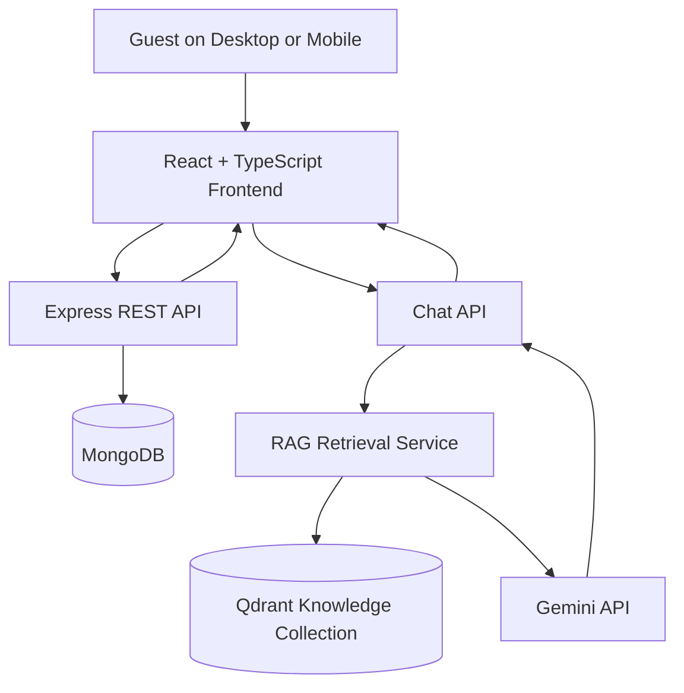

# HotelLair — MVP 1

**A full-stack accommodation discovery and booking platform with an AI-powered RAG chatbot.**

> **Project status:** MVP 1 — Core features implemented and tested locally and on mobile through temporary Cloudflare tunnels.

## Table of Contents

- [Overview](#overview)
- [MVP 1 Features](#mvp-1-features)
- [Technology Stack](#technology-stack)
- [Architecture](#architecture)
- [Project Structure](#project-structure)
- [Getting Started](#getting-started)
- [Environment Variables](#environment-variables)
- [API Reference](#api-reference)
- [RAG Chatbot](#rag-chatbot)
- [Booking Workflow](#booking-workflow)
- [Demo Data](#demo-data)
- [Testing and Validation](#testing-and-validation)
- [Known Limitations](#known-limitations)
- [Next Development Milestones](#next-development-milestones)

---

## Overview

HotelLair is a full-stack accommodation discovery and booking application designed to help guests explore properties, review accommodation details, submit booking requests, and ask questions through an AI-powered chatbot.

The project combines a React frontend, a Node.js/Express backend, MongoDB for application data, and a retrieval-augmented generation (RAG) pipeline that uses Gemini and Qdrant to answer questions about HotelLair.

MVP 1 focuses on connecting the main application components into a working end-to-end experience.

### Core objectives

- Display accommodation listings fetched from a backend API.
- Allow users to select a property and submit a booking request.
- Store application data in MongoDB.
- Provide a chatbot that retrieves relevant information from a dedicated knowledge base.
- Support mobile browsing and interaction.
- Establish a foundation for future administrative and production features.

## MVP 1 Features

| Feature | Status |
|---|---|
| Responsive React frontend | Implemented |
| Property listings from MongoDB | Working |
| Property selection | Working |
| Booking request form | Working |
| Backend booking validation | Implemented |
| Booking requests stored in MongoDB | Implemented |
| Gemini-powered RAG chatbot | Working; subject to model availability |
| Knowledge ingestion into Qdrant | Completed |
| Mobile testing through Cloudflare Quick Tunnels | Successful |
| Admin dashboard | Not implemented |
| Booking management interface | Not implemented |
| Online payment integration | Not implemented |
| Production deployment | Not completed |

## Technology Stack

### Frontend

- **React** — component-based user interface.
- **TypeScript** — static typing.
- **Vite** — development server and build tooling.
- **Tailwind CSS v4** — utility-first styling.
- **Context API** — shared booking search criteria and selected-property state.

### Backend

- **Node.js** — JavaScript runtime.
- **Express 5** — HTTP API and routing.
- **TypeScript** — backend application code.
- **Mongoose** — MongoDB models and database operations.
- **Zod** — request validation.
- **CORS** — cross-origin request configuration.
- **dotenv** — environment configuration.

### AI and retrieval

- **Google Gemini API** — generates chatbot responses.
- **Gemini Embedding API** — converts knowledge chunks into vector embeddings.
- **Qdrant** — stores and retrieves knowledge embeddings.
- **Custom RAG pipeline** — chunks documents, generates embeddings, retrieves relevant content, and supplies that context to the language model.

The current RAG implementation uses a direct application pipeline rather than relying on LangChain or LlamaIndex.

### Development and infrastructure

- MongoDB / MongoDB Atlas
- Docker-hosted Qdrant
- Cloudflare Quick Tunnels for temporary remote mobile testing
- npm for package management and scripts

## Architecture



### Data responsibilities

- **MongoDB:** property records and booking requests.
- **Qdrant:** searchable vector representations of HotelLair knowledge.
- **Gemini:** natural-language answer generation using retrieved context.
- **React:** property browsing, booking forms, and chatbot interaction.

MongoDB and Qdrant serve different purposes. Ingesting chatbot knowledge into Qdrant does not automatically make MongoDB booking records available to the chatbot.

## Project Structure

The main application is organised into separate frontend and backend applications.

```text
Hotel-web/
├── frontend/
│   ├── src/
│   │   ├── components/
│   │   │   ├── booking/
│   │   │   │   └── BookingForm.tsx
│   │   │   ├── chat/
│   │   │   │   └── ChatWidget.tsx
│   │   │   ├── home/
│   │   │   │   ├── ChooseRooms.tsx
│   │   │   │   └── ...
│   │   │   └── layout/
│   │   ├── context/
│   │   │   └── BookingSearchContext.tsx
│   │   ├── lib/
│   │   │   └── properties.ts
│   │   ├── pages/
│   │   │   └── Homepage.tsx
│   │   ├── App.tsx
│   │   └── App.css
│   ├── .env
│   └── package.json
│
├── backend/
│   ├── src/
│   │   ├── controllers/
│   │   ├── models/
│   │   ├── routes/
│   │   ├── middleware/
│   │   ├── validation/
│   │   ├── data/
│   │   │   └── knowledge.md
│   │   ├── rag/
│   │   │   ├── chunker.ts
│   │   │   ├── embeddings.ts
│   │   │   ├── ingest.ts
│   │   │   ├── retrieve.ts
│   │   │   └── vectorStore.ts
│   │   ├── services/
│   │   │   └── chatService.ts
│   │   └── scripts/
│   │       └── seedProperties.ts
│   ├── .env
│   └── package.json
│
└── README.md
```

*This is a structural overview; exact filenames and additional modules may vary in the current working tree.*

## Getting Started

### Prerequisites

Install or configure:

- Node.js and npm.
- MongoDB or a MongoDB Atlas database.
- Docker, for the local Qdrant instance.
- A Google Gemini API key.
- Git, if cloning the repository.

### 1. Clone or open the project

If using Git:

```bash
git clone <your-repository-url>
cd Hotel-web
```

Alternatively, open the existing project directory.

### 2. Install frontend dependencies

```bash
cd frontend
npm install
```

### 3. Install backend dependencies

Open a second terminal:

```bash
cd backend
npm install
```

### 4. Configure environment variables

Create the required `.env` files using the examples below. Never commit real API keys, passwords, database credentials, or JWT secrets.

### 5. Start the infrastructure

Ensure MongoDB is reachable and Qdrant is running.

The development Qdrant service has been configured on port `6333`.

If using Docker, the following is an example of a fresh local Qdrant setup:

```bash
docker run -d \
  --name hotellair-qdrant \
  -p 6333:6333 \
  qdrant/qdrant
```

If Qdrant is already running, reuse the existing instance rather than creating a conflicting container. Preserve other projects' collections.

### 6. Start the backend

```bash
cd backend
npm run dev
```

The backend has previously started successfully at:

`http://localhost:8080`

### 7. Start the frontend

```bash
cd frontend
npm run dev
```

The frontend has previously run at:

`http://localhost:5173`

Keep both development servers running while testing the application.

### 8. Seed demo properties

From the backend directory, run the configured seed script:

```bash
npm run seed:properties
```

The script previously inserted 18 demo property listings. It checks property names before inserting, so existing records are skipped rather than deleted.

### 9. Ingest chatbot knowledge

From the backend directory:

```bash
npm run ingest:knowledge
```

The knowledge ingestion process previously completed successfully with approximately 26 chunks after the property directory was added to `knowledge.md`.

Do not delete the existing Qdrant `docs` collection. HotelLair uses its own `hotellair_knowledge` collection.

## Environment Variables

### Frontend — `frontend/.env`

```env
VITE_API_URL=http://localhost:8080
```

For local development, this points to the Express API.

When testing through Cloudflare tunnels, use the actual backend tunnel URL instead.

### Backend — `backend/.env`

```env
PORT=8080
MONGO_URI=your_mongodb_connection_string
JWT_SECRET=your_long_random_secret
FRONTEND_URL=http://localhost:5173

GEMINI_API_KEY=your_gemini_api_key

QDRANT_URL=http://localhost:6333
QDRANT_COLLECTION=hotellair_knowledge
```

These are illustrative variable names based on the current configuration. Preserve any additional variables already required by the implementation.

**Important:** Never commit `.env` files to a public repository. Use `.env.example` files containing placeholders instead.

## API Reference

The backend exposes REST endpoints under `/api`.

### Properties

Base path: `/api/properties`

| Method | Endpoint | Purpose |
|---|---|---|
| GET | `/api/properties` | Retrieve property listings |
| GET | `/api/properties/:id` | Retrieve one property |
| POST | `/api/properties` | Create a property; protected |
| PATCH | `/api/properties/:id` | Update a property; protected |
| DELETE | `/api/properties/:id` | Delete a property; protected |

The listing endpoint returns a response containing `success`, `count`, and `data`.

### Bookings

Base path: `/api/bookings`

| Method | Endpoint | Purpose |
|---|---|---|
| POST | `/api/bookings` | Submit a guest booking request |
| GET | `/api/bookings` | Retrieve bookings; protected |

Additional booking routes may exist in the current backend implementation.

#### Example booking request

```json
{
  "property": "PROPERTY_MONGODB_ID",
  "guestName": "Test Guest",
  "guestEmail": "guest@example.com",
  "guestPhone": "08000000000",
  "checkIn": "2026-11-10T12:00:00.000Z",
  "checkOut": "2026-11-13T12:00:00.000Z",
  "guests": 2,
  "specialRequests": "Late arrival"
}
```

Replace the example property ID and dates with valid values.

The backend validates the request, checks property availability and guest capacity, checks for overlapping pending or confirmed bookings, and creates a booking request.

Successful submissions return HTTP `201` with a success message and booking data.

**A successful request is not a confirmed reservation.** New bookings have a pending status by default.

### Chatbot

Endpoint: `POST /api/chat`

#### Example request

```json
{
  "question": "Which properties do you have in Calabar?"
}
```

The chatbot retrieves relevant knowledge from Qdrant and uses Gemini to generate a response.

The exact response depends on the backend's chat response schema and the availability of the configured Gemini model.

## RAG Chatbot

The HotelLair assistant uses retrieval-augmented generation to answer questions using the application's knowledge base.

### Processing pipeline

1. HotelLair knowledge is maintained in `backend/src/data/knowledge.md`.
2. The ingestion process divides the document into smaller chunks.
3. Gemini embeddings are generated for the chunks.
4. The embeddings and associated metadata are stored in Qdrant.
5. When a guest asks a question, the system retrieves relevant chunks.
6. The retrieved context is passed to Gemini to generate an answer.
7. The response is returned to the frontend and displayed in the chat interface.

### Knowledge base

The knowledge file contains HotelLair information, property descriptions, sample locations, prices, amenities, and chatbot guidance.

The current knowledge base has been expanded to include the 18 demo properties.

### RAG configuration

| Setting | Current value |
|---|---|
| Vector database | Qdrant |
| HotelLair collection | `hotellair_knowledge` |
| Embedding model | `gemini-embedding-001` |
| Embedding dimensions | 3072 |
| Knowledge ingestion | Implemented |
| Retrieval | Implemented |
| Answer generation | Gemini API |

### Important chatbot behaviour

- Property details should reflect retrieved knowledge.
- Prices should be presented in Nigerian naira where specified.
- The chatbot must not claim that a property is available for particular dates unless availability has actually been verified.
- The chatbot must not invent booking confirmations.
- Booking information in MongoDB is not automatically searchable through the RAG knowledge collection.

### Known AI limitation

Gemini has returned `503 Service Unavailable` errors due to model demand or temporary service availability.

The ingestion process has already completed, but the chatbot still depends on successful model API calls for answer generation. Provider errors, quotas and rate limits can affect availability.

## Booking Workflow

The current guest booking workflow is:

1. The guest browses property listings.
2. The guest selects a property.
3. The selected property is shared through the booking search context.
4. The booking form collects guest details, dates, guest count and optional special requests.
5. The frontend sends a request to the Express booking endpoint.
6. The backend validates the request and checks booking conflicts.
7. The booking request is saved to MongoDB.
8. The frontend displays a success or error message.

### Current limitation

The guest-facing booking submission has been tested successfully.

However, MVP 1 does not yet provide a complete administrative interface for viewing, approving, rejecting or managing submitted booking requests. A success message confirms submission, not that an administrator has accepted the reservation.

## Demo Data

The property seeding script previously created 18 sample listings across 10 Nigerian destinations:

- Lagos
- Abuja
- Port Harcourt
- Ibadan
- Enugu
- Uyo
- Benin City
- Calabar
- Abeokuta

The demo catalogue includes sample apartments, studios, executive suites and family accommodation, with prices and amenities stored in MongoDB.

**These are development demo listings, not verified accommodation offers.** Confirm real properties, pricing, inventory and operational arrangements before using the site for real customer bookings.

## Testing and Validation

The following milestones have been completed or observed during MVP 1 development:

- [x] Backend connects successfully to MongoDB.
- [x] Property seed script inserts demo listings.
- [x] Frontend retrieves properties from the API.
- [x] Property selection works.
- [x] Booking form submits successfully.
- [x] Booking success confirmation displays.
- [x] RAG ingestion completes successfully.
- [x] Chatbot responds when the configured Gemini service is available.
- [x] Frontend and backend communicate through Cloudflare tunnels.
- [x] Property listings display on a mobile phone.
- [x] Booking and chatbot functionality have been tested on mobile.
- [x] Mobile input zoom and chatbot panel height have received initial CSS adjustments.

The mobile swipe interaction between the open chatbot and homepage carousel remains under investigation. It should be retested and fixed before considering the mobile UI fully polished.

Successful development builds have previously been reported for both the frontend and backend. Run the current build scripts again before a release.

## Known Limitations

MVP 1 is a working development milestone, not a production-ready accommodation marketplace.

### Product limitations

- No complete admin dashboard.
- No dedicated booking approval and management interface.
- No payment gateway integration.
- No complete production inventory and availability management workflow.
- Demo listings and remote image URLs are used.
- No verified production accommodation inventory.

### AI limitations

- Gemini API availability can interrupt chat responses.
- The knowledge base must be re-ingested when its content changes.
- RAG answers depend on retrieval quality and model behaviour.
- Booking records are not automatically included in chatbot retrieval.

### Infrastructure and security limitations

- Cloudflare Quick Tunnels provide temporary development URLs.
- Public tunnels expose the development application and API.
- The development setup has not been established as a hardened production deployment.
- Production authentication, authorisation, rate limiting, monitoring and security controls require further review.

## Next Development Milestones

### MVP 1.1 — Stabilisation

- Resolve the mobile chatbot and homepage carousel swipe conflict.
- Test mobile layouts across different screen sizes and browsers.
- Verify booking records in MongoDB after submission.
- Test booking validation and overlapping-date scenarios.
- Add more robust error handling for Gemini service failures.
- Verify RAG retrieval accuracy against the full property directory.
- Add regression checks for the working frontend and backend flows.

### MVP 2 — Administration and operations

- Build a secure admin dashboard.
- View and search booking requests.
- Approve, reject and update booking statuses.
- Create, edit and manage property listings.
- Manage property availability and inventory.
- Introduce appropriate notifications for new booking requests.
- Add operational reporting where needed.

### Production readiness

- Deploy the frontend and backend to stable hosting.
- Configure permanent HTTPS domains and production environment variables.
- Add structured logging, monitoring and API rate limiting.
- Review authentication, authorisation, input validation and data protection.
- Integrate payments if required by the business.
- Replace demo listings with verified property information.
- Run end-to-end and security testing before public launch.

---

## MVP 1 Summary

HotelLair MVP 1 establishes a working full-stack foundation: guests can browse property listings retrieved from MongoDB, submit booking requests, and interact with a RAG-powered chatbot backed by Gemini and Qdrant.

The next phase focuses on mobile interaction polish, stronger testing, reliable AI error handling, and administrative booking management.

**Project:** HotelLair  
**Milestone:** MVP 1  
**Primary goal:** Working property discovery, booking submission and AI-assisted guest information  
**Next priority:** Stabilisation and admin dashboard development
